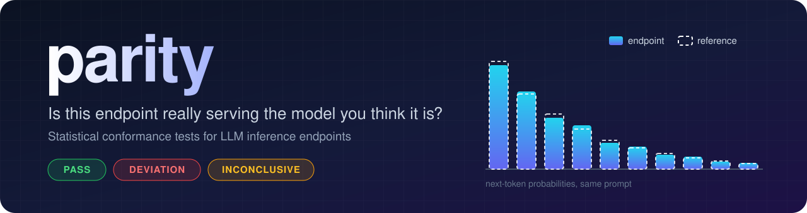
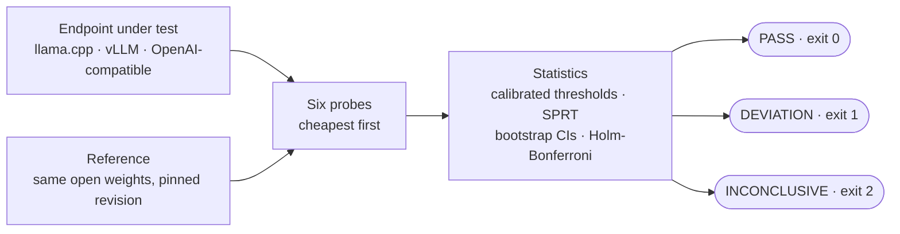

<p align="center">
  
</p>

<p align="center">
  <a href="https://github.com/raunaksahahere/parity/actions/workflows/ci.yml"></a>
  
  <a href="LICENSE"></a>
  
  
</p>

<p align="center">
  <a href="#quickstart"><b>Quickstart</b></a> ·
  <a href="#what-it-catches"><b>What it catches</b></a> ·
  <a href="#how-it-works"><b>How it works</b></a> ·
  <a href="#measured-results"><b>Results</b></a> ·
  <a href="#use-it-in-ci"><b>CI</b></a> ·
  <a href="docs/methodology.md"><b>Methodology</b></a>
</p>

---

You run, or pay for, an open-weight model behind an OpenAI-compatible API. **Is the server
really running those weights, with the right chat template, and a sampler that honours your
`temperature` and `top_k`?** Quantized weights, a broken template, ignored sampling parameters
and silently truncated prompts all still produce fluent text, so you can't spot them by reading
outputs.

**Parity** sends cheap probes to the endpoint, runs the same inputs through a pinned reference
implementation of the same model, and uses statistics to decide whether the two differ by more
than the numerical noise that separates any two correct deployments.

```console
$ parity run --model Qwen/Qwen3-0.6B --revision c1899de289a04d12100db370d81485cdf75e47ca \
             --target http://127.0.0.1:8081 --served-model qwen3 --claimed-context 4096
Running suite 'core' against http://127.0.0.1:8081 (reference hf:local)
  template.token_counts          PASS         requests=7 effect=0
  distribution.teacher_forced    PASS         requests=303 effect=7.338e-06
  greedy.agreement               PASS         requests=4 effect=0
  sampler.conformance            PASS         requests=6504 effect=0
  longctx.needle                 PASS         requests=9 effect=0
  tools.structured               PASS         requests=32 effect=0

Verdict: PASS. No deviation from the reference was detected by the evaluated probes.
```

<sub>A real run: llama.cpp b12128 serving the BF16 GGUF on an RX 6500M laptop GPU; reference = Hugging Face transformers, fp32, CPU.</sub>

## Three answers, and nothing more

| Verdict | Exit | Meaning |
|---|:-:|---|
| ✅ **PASS** | `0` | No difference beyond calibrated benign variation was found by the probes that ran. |
| ❌ **DEVIATION** | `1` | Behaviour differs from the reference, with evidence, and the report names the probe that found it. |
| ⚠️ **INCONCLUSIVE** | `2` | Not enough evidence either way (or an error). Parity never guesses. |

Every report also lists what the result does **not** prove. A verdict is evidence, not a
certificate ([limits](#limits-read-these)).

## What it catches

Every row below is a fault that was **injected into a real llama.cpp deployment and detected in
every repetition** of the [validation study](docs/validation.md).

| What went wrong | How it was produced | Caught by |
|---|---|---|
| Quantized weights served as the full model | Q8_0, Q4_K_M or Q2_K GGUF instead of BF16 | 📊 distribution, 🎯 greedy |
| Wrong or broken chat template | llama3 template, or a template without a system role | 🧩 template, 📏 long-context |
| Sampling parameters ignored | `top_k`, `top_p` or `temperature` dropped by the server | 🎲 sampler (and 🎯 greedy for temperature) |
| Temperature mis-scaled | temperature x1.5 | 🎲 sampler |
| Smaller context than advertised | 2,048 tokens served, 4,096 claimed | 📏 long-context |
| Silent prompt truncation | long prompts cut down without an error | 📏 long-context |

## The six probes

| | Probe | The question it asks | Evidence |
|:-:|---|---|---|
| 🧩 | `template.token_counts` | Does the server format chats exactly like the official template? | Local render of the official template vs the server's `usage.prompt_tokens`; names the cause (dropped system prompt, duplicated BOS, tool formatting, ...) |
| 📊 | `distribution.teacher_forced` | Are next-token probabilities the same as the reference's? | Truncated-KL lower bound on a fixed corpus, document-cluster bootstrap, equivalence-style decision |
| 🎯 | `greedy.agreement` | Does temperature-0 output follow the same tokens? | Per-token divergence hazard, tested sequentially (SPRT) |
| 🎲 | `sampler.conformance` | Do `temperature`, `top_k` and `top_p` do what they say? | Every sample checked against the distribution reported in its own response; G-test |
| 📏 | `longctx.needle` | Is the whole advertised context really used? | Token accounting at increasing lengths, needle retrieval, rejections inside the claimed window |
| 🛠️ | `tools.structured` | Are tool calls and JSON outputs valid, and like the reference's? | Tool-name and argument-schema validity, JSON-schema adherence, trigger agreement vs the reference |

Probes run cheapest first, so `--fail-fast` reaches a DEVIATION after as few as 7 requests.

## Quickstart

**1. Install** (from a checkout for now; the PyPI package `llm-parity` is not published yet)

```bash
git clone https://github.com/raunaksahahere/parity && cd parity
pip install torch --index-url https://download.pytorch.org/whl/cpu   # CPU PyTorch for the local reference
pip install ".[reference]"
```

**2. Serve a known-good baseline.** The BF16 GGUF has the same precision as the reference
weights, so a correct server should PASS:

```bash
hf download unsloth/Qwen3-0.6B-GGUF Qwen3-0.6B-BF16.gguf \
   --revision 50968a4468ef4233ed78cd7c3de230dd1d61a56b --local-dir models
llama-server -m models/Qwen3-0.6B-BF16.gguf --port 8081 --jinja -c 16384 --parallel 4
```

**3. Compare it with the reference** (downloads `Qwen/Qwen3-0.6B` once, pinned by revision)

```bash
parity run --model Qwen/Qwen3-0.6B --revision c1899de289a04d12100db370d81485cdf75e47ca \
           --target http://localhost:8081 --served-model qwen3 --claimed-context 4096
echo $?   # 0 pass · 1 deviation · 2 inconclusive or error
```

Then open `parity-runs/<run-id>/report.html`.

> [!TIP]
> **Calibrate before you trust a verdict.** Thresholds should come from deployments you know are
> correct but that differ in harmless ways (backend, slots, batch size). Same-configuration
> repeats are often bit-identical and would make Parity flag every honest change.
>
> ```bash
> llama-server -m models/Qwen3-0.6B-BF16.gguf --port 8082 --jinja -c 16384 --parallel 4 --device none  # CPU copy
> parity calibrate --model Qwen/Qwen3-0.6B --revision c1899de289a04d12100db370d81485cdf75e47ca \
>                  --served-model qwen3 --benign gpu=http://localhost:8081 --benign cpu=http://localhost:8082
> parity run ... --calibration calibration.json
> ```

**What to expect**

| Endpoint | Expected | Why |
|---|---|---|
| BF16 GGUF, llama.cpp | ✅ PASS | Same precision as the reference; KL around 1e-5 nats |
| Q8_0 GGUF, calibrated | ❌ DEVIATION (distribution probe) | A real, if small, numerical change: KL ~1.3e-3 nats, about 9x the calibrated benign threshold |
| Q4_K_M or Q2_K GGUF | ❌ DEVIATION (greedy + distribution) | Large changes in next-token probabilities |

A cold run loads the fp32 reference on the CPU (Qwen3-0.6B: 4.4 GB peak RSS for the whole run
on the test laptop); later runs reuse the on-disk reference cache.

## How it works



1. **Same inputs, two implementations.** Probes send token-id prompts (when the server accepts
   them) so the endpoint and the reference see exactly the same tokens.
2. **Calibrated, not guessed.** Thresholds sit just above the variation measured between known-good
   deployments, never at zero.
3. **Stop early, stay honest.** Sequential tests (SPRT) stop as soon as the evidence is clear; Holm-Bonferroni
   keeps the familywise error rate at `alpha` across probes; bootstrap intervals respect document
   structure.
4. **Equivalence, not just difference.** The distribution probe passes only when the upper confidence
   bound is *below* the threshold; otherwise it is DEVIATION or INCONCLUSIVE.

Details, and the places where each procedure can mislead: [docs/methodology.md](docs/methodology.md).

<!-- RESULTS:BEGIN -->
## Measured results

Qwen3-0.6B on a laptop (CPU + RX 6500M), 23 correct-deployment controls and 11 injected faults x 3 repetitions. Method, controls and caveats: [docs/validation.md](docs/validation.md).

False positives on correct deployments (held-out controls): **0/23** runs (95% CI 0.0-14.8%), nominal alpha 0.05.

| Injected fault | Detected | Flagged by | Requests to detection (fail-fast) | Full-suite requests | Full-suite time |
|---|---|---|---:|---:|---:|
| template-nosystem | 3/3 | template, longctx | 7 | 6859 | 2.3 min |
| template-llama3 | 3/3 | template, longctx | 7 | 7359 | 118 s |
| topk-ignored | 3/3 | sampler | 5259 | 5259 | 2.0 min |
| topp-ignored | 3/3 | sampler | 6559 | 6559 | 2.2 min |
| temperature-ignored | 3/3 | greedy, sampler | 52 | 4959 | 108 s |
| temperature-x1.5 | 3/3 | sampler | 2759 | 2759 | 74 s |
| silent-truncation | 3/3 | longctx | 16 | 7359 | 2.5 min |
| ctx-reduced | 3/3 | longctx | 16 | 6859 | 118 s |
| quant-q2_k | 3/3 | greedy, distribution, sampler (1/3) | 52 | 3359 | 80 s |
| quant-q4_k_m | 3/3 | greedy, distribution | 52 | 6359 | 81 s |
| quant-q8_0 | 3/3 | distribution | 355 | 6859 | 88 s |

The `sampler (1/3)` on Q2_K was a misattribution by sampler v2 (numerical jitter between requests). Sampler v3, re-validated alone on the GPU deployments, reported DEVIATION on 12/12 sampler-fault repetitions and on 0/26 others, including 0/10 on Q2_K.
<!-- RESULTS:END -->

## Use it in CI

The repository is a GitHub Action. Gate an inference upgrade on "still serves the same model":

```yaml
- uses: raunaksahahere/parity@v0.1.0
  env:
    STAGING_API_KEY: ${{ secrets.STAGING_API_KEY }}   # read from the environment only
  with:
    model: Qwen/Qwen3-0.6B
    revision: c1899de289a04d12100db370d81485cdf75e47ca
    target: https://staging.example.com/v1
    served-model: qwen3-0.6b
    api-key-env: STAGING_API_KEY
    calibration: ci/parity-calibration.json
    budget: "8000"
    fail-on: deviation
```

Full example: [docs/examples/upgrade-gate.yml](docs/examples/upgrade-gate.yml). The step summary
shows the Markdown report; `report.html`, `report.md` and `report.json` are uploaded as an artifact.

<details>
<summary><b>More ways to run it: Python API, Docker, canary with Prometheus</b></summary>

**Python API**

```python
import parity

reference = parity.hf_reference(
    "Qwen/Qwen3-0.6B", revision="c1899de289a04d12100db370d81485cdf75e47ca"
)
target = parity.Target("http://localhost:8081", "qwen3")
report = parity.Suite(name="core").run(target, reference)
print(report.verdict, report.exit_code)
```

**Docker**: a [Dockerfile](Dockerfile) with CPU PyTorch is included
(`docker build -t parity .`; `--build-arg WITH_REFERENCE=0` for a small image that uses a URL reference).

**Canary mode**: `parity canary --interval 3600 --port 9108 ...` runs the suite on a schedule and
serves Prometheus metrics (`parity_verdict`, `parity_probe_status`, ...).

**CLI**: `parity run | report | calibrate | list-probes | history | canary | inject-faults`.
Secrets are read from environment variables only (`--api-key-env NAME`) and never written to
reports; target URLs are stored without credentials or query strings.

</details>

## Limits (read these)

> [!IMPORTANT]
> A report is evidence about *behaviour on these probes*, not a certificate.

- **PASS is not proof of identity.** It means no difference beyond the calibrated benign variation
  was found at this sample size. Smaller differences, and behaviour the probes do not exercise
  (other languages, long documents, safety behaviour), can remain.
- **DEVIATION is not an accusation.** It cannot tell a different checkpoint from a quantization, a
  template bug or a serving bug, and it says nothing about intent.
- **The reference is an implementation, not ground truth.** Two correct implementations differ
  numerically. A legitimate variant outside the calibrated family (other hardware or kernels) can
  look like a deviation.
- **KL is a lower bound** (truncated top-k), so the true divergence can be larger.
- **Capabilities gate power.** Endpoints without token-id prompts or log-probs skip the
  distribution, greedy and sampler probes; the report says so.
- **Validated scope.** Live validation so far: one small model (Qwen3-0.6B) on llama.cpp. The vLLM
  and generic OpenAI adapters are built from documented formats and tested with fixtures only. The
  tool probe has little statistical power with its current prompt set. The shipped corpus is small
  and mostly English. Full list: [methodology](docs/methodology.md#8-known-limitations).

## Documentation

| | |
|---|---|
| 📐 [Methodology](docs/methodology.md) | Every statistical procedure and where it can mislead |
| 🧪 [Validation study](docs/validation.md) | Controls, injected faults, raw data in [docs/data](docs/data) |
| 📉 [Baseline noise](docs/baseline-noise.md) | How much two correct deployments differ |
| 🧭 [Decisions](docs/decisions.md) | Non-obvious choices, recorded as they were made |
| 🧱 [Adding a probe](docs/adding-probes.md) · [Contributing](CONTRIBUTING.md) · [Changelog](CHANGELOG.md) | |
| 📄 Sample reports | Q4_K_M flagged: [HTML](docs/sample-report-deviation.html) · [Markdown](docs/sample-report-deviation.md). Correct BF16 deployment: [HTML](docs/sample-report-pass.html) · [Markdown](docs/sample-report-pass.md) |
| 🎬 Terminal demo | Honest BF16 server vs Q2_K, recorded from real runs: [docs/demo.cast](docs/demo.cast) (`asciinema play docs/demo.cast`) |

## License

[Apache-2.0](LICENSE)
